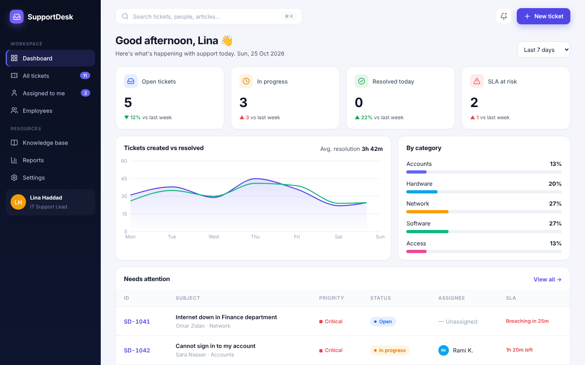
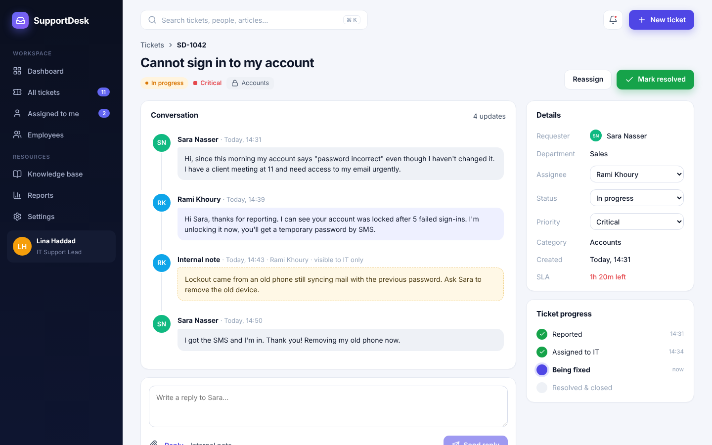
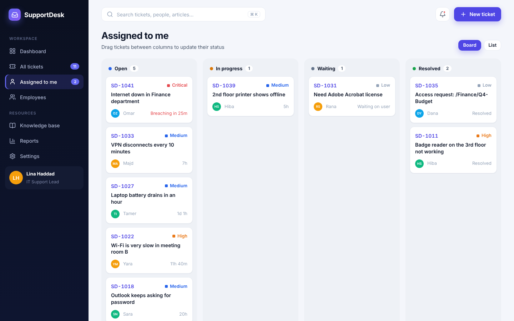
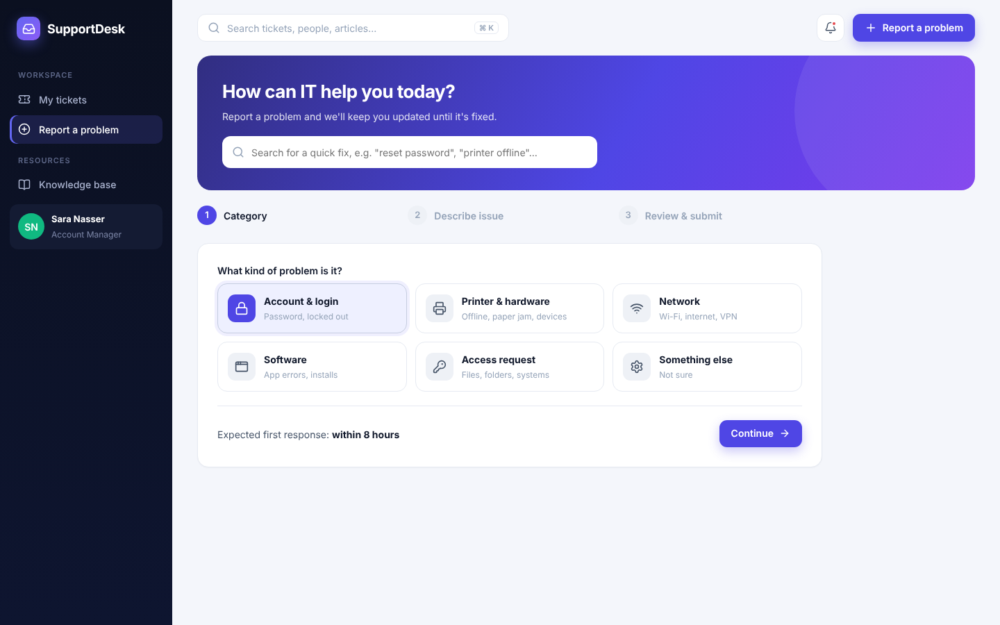
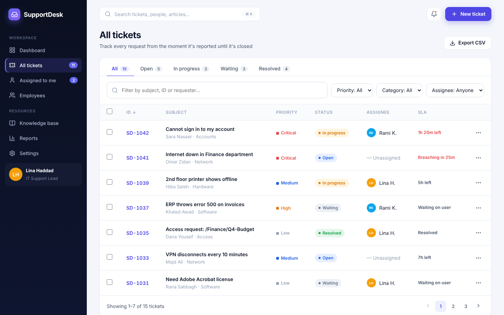

# SupportDesk

An internal IT help desk for a company of about 50 people. Instead of calling IT or sending WhatsApp messages, an employee opens a **ticket**, and the IT team follows it until it is closed. The app tracks each ticket from the moment it is reported to the moment it is resolved.

I built this as a front-end project to practise React, TypeScript and designing a real product with several user roles. There is no backend yet, so all data lives in the browser (`localStorage`).



## Features

**For employees**
- Report a problem with a 3-step form (category, description, review). The draft is saved automatically.
- Search the knowledge base while typing, and open a ticket from an article if it didn't help.
- "My tickets" with a progress bar for each ticket, and a highlight when IT is waiting for an answer.
- Reply in the ticket conversation.

**For the IT team**
- Dashboard with KPIs, a chart, tickets per category and a "needs attention" list sorted by priority and SLA.
- Ticket list with tabs, search, filters in the URL, sorting, pagination, bulk actions and CSV export.
- Ticket page with the conversation, internal notes (only IT sees them), reassigning, status and priority changes.
- Kanban board with drag and drop to change status.
- Employees page, reports page and settings (SLA policies, auto-assign rules, notifications).

**General**
- Two roles (employee / agent) with protected routes.
- SLA countdown on every open ticket, turns red when a ticket is close to breaching.
- Command palette (`Ctrl/Cmd + K`), shortcuts (`c` new ticket, `g d` dashboard, `g t` tickets).
- Dark mode, responsive layout (sidebar becomes a drawer on mobile), form validation, toasts and confirm dialogs.

## Screenshots

| Ticket detail | Kanban board |
| --- | --- |
|  |  |

| New ticket | Tickets list |
| --- | --- |
|  |  |

More in [`docs/screenshots`](docs/screenshots).

## Tech stack

- React 19 + TypeScript, built with Vite
- React Router for routing
- Recharts for the charts
- lucide-react for icons
- Plain CSS with design tokens (`src/styles/tokens.css`), no UI library

I kept the dependencies small on purpose. State is a `useReducer` inside a React context instead of Redux or Zustand because the app is small, and the drag and drop on the board uses the native HTML5 API.

## Getting started

```bash
git clone https://github.com/<your-username>/supportdesk.git
cd supportdesk
npm install
npm run dev
```

Then open http://localhost:5173 and sign in with one of the demo accounts (any password with 6 or more characters works):

| Role | Email |
| --- | --- |
| IT agent | `lina.haddad@company.com` |
| Employee | `sara.nasser@company.com` |

You can also switch role from the user menu at the bottom of the sidebar. To reset the demo data, clear the site data for `localhost` in your browser.

Other scripts: `npm run build`, `npm run preview`, `npm run lint`.

## Project structure

```
src/
  components/
    layout/      sidebar, top bar, command palette, route guard
    tickets/     the ticket table used on several pages
    ui/          buttons, badges, modal, menu, toast, form controls...
  data/          seed data (users, tickets) and knowledge base articles
  hooks/         keyboard shortcuts
  lib/           labels, SLA and time helpers, sample chart data
  pages/         one file per screen
  store/         global state (reducer + localStorage persistence)
  styles/        tokens, base, components, layout, pages
  types.ts       Ticket, User, Message, SlaPolicy...
```

## How it works

- A ticket has a `status` (open, in progress, waiting, resolved) and a `priority`. The priority decides the SLA deadline (`slaDueAt`), using the policies from the settings page.
- `getSla()` in `src/lib/time.ts` turns a ticket into the text shown in the UI ("1h 20m left", "Breaching in 25m", "Waiting on user").
- When an agent replies to an unassigned ticket, the ticket is assigned to them. When the employee answers a ticket that was waiting, it goes back to "in progress".
- Internal notes are filtered out for employees in the ticket page.

## Known limitations

- No real backend or authentication. Passwords are not checked and everything resets with the browser storage.
- File attachments only keep the file name.
- The charts on the dashboard and reports page use sample numbers (`src/lib/stats.ts`), because the seed data doesn't have enough history.
- Emails and Slack/Teams notifications are only settings, nothing is sent.

## Ideas for next steps

- Node/Express (or Supabase) API with a database and real login (JWT)
- Real file uploads and email notifications
- Tests: unit tests for the SLA helpers and reducer, Playwright for the main flows
- Arabic translation with RTL layout
- Real-time updates with WebSockets

## Design

The interface follows a "modern SaaS" style: dark navy sidebar, indigo accent, soft cards, status colours that are reused everywhere (open = blue, in progress = amber, waiting = grey, resolved = green). Colours, radii and shadows are defined once as CSS variables.
